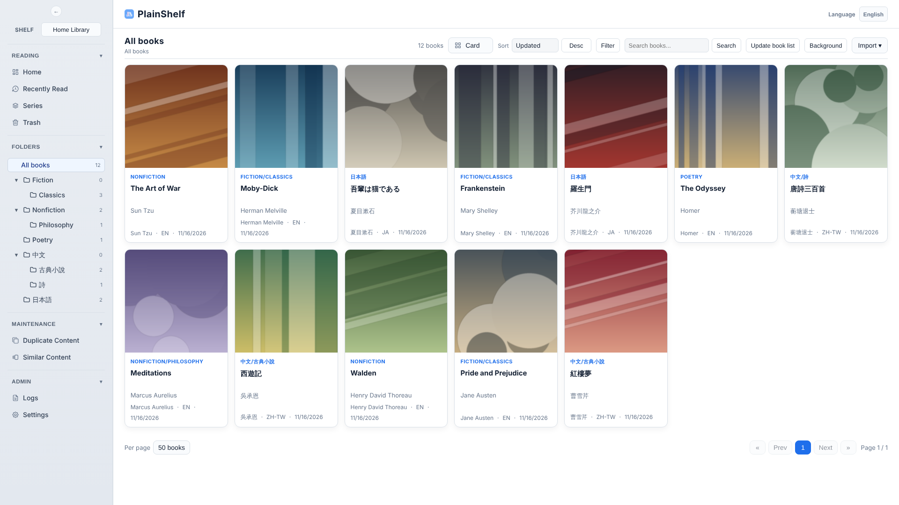

# PlainShelf

[](https://pkg.go.dev/github.com/voilelab/plainshelf)
[](LICENSE)
[](https://github.com/voilelab/plainshelf/actions/workflows/ci.yml)
[](https://hub.xerj.org/contributors/mudream4869)

PlainShelf is a local-first, single-user reading library for lightweight text
content. It stores the library in human-readable files and provides web,
desktop, and experimental Android clients. Local-first is also a security
stance: PlainShelf operates no service that holds your library, reading records
or credentials. Your own server or device reads the credentials needed for the
remote sources you configure. See
[Deployment and threat model](docs/deployment-and-threat-model.md) for what each
deployment does and does not protect.

> **Before 1.0:** until `1.0.0-rc1` freezes the on-disk format, an upgrade can
> still change it. Back up your shelf before upgrading; see
> [Backup and restore](docs/backup-and-restore.md) and
> [Data format versioning](docs/concepts/data-format-versioning.md).



## What it does

- Imports and reads plain text and Markdown books
- Imports EPUB files by converting them to plain text, Markdown, or comic pages
- Imports CBZ comics as ordered image pages and reads them one page at a time
- Organizes books in nested, filesystem-backed folders
- Keeps stable book IDs when titles or folders change
- Supports covers, metadata, bookmarks, reading history, and reading stats
- Runs as a local server, a macOS desktop app, or an experimental Android client
  that reads from a server or straight from a shelf folder on pCloud

PlainShelf is not a Calibre replacement. EPUB and CBZ are import formats, not
storage formats, and the pCloud support is read-only storage, not sync. See
[Project boundaries](docs/index.md#project-boundaries) for what is out of scope.

## Try it

[Open the demo](https://plainshelf.org/demo/): the full web app running in your
browser, with nothing to install and nothing uploaded. See
[Try the demo](docs/try-the-demo.md) for where it keeps your library and how to
move a library between it and a real install.

## Install

On Apple Silicon macOS:

```bash
brew install --cask voilelab/plainshelf/plainshelf
```

Prebuilt server archives and Docker images are also available. See the
[installation guide](docs/installation.md), then follow
[Getting started](docs/getting-started.md).

## Develop

```bash
npm --prefix frontend ci
npm --prefix frontend run build
go test ./...
```

The Go server embeds `frontend/dist`, so build the frontend before running Go
builds or tests. Full setup, desktop, mobile, Docker, and test instructions are
in the [development guide](docs/development/setup.md).

## Documentation

- [Documentation home](docs/index.md)
- [Try the demo](docs/try-the-demo.md)
- [Installation](docs/installation.md)
- [Getting started](docs/getting-started.md)
- [Local shelf configuration](docs/configuring-local-shelf.md)
- [SMB shelf configuration](docs/configuring-smb-shelf.md)
- [EPUB import](docs/epub-import.md) and [CBZ import](docs/cbz-import.md)
- [Android app](docs/android-app.md)
- [Deployment and threat model](docs/deployment-and-threat-model.md)
- [Backup and restore](docs/backup-and-restore.md)
- [Data model](docs/concepts/data-model.md)
- [Known issues](docs/known-issue.md)

## License

[BSD 3-Clause](LICENSE)
